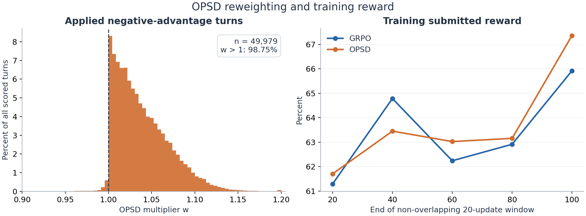

# 证据与统计口径

## 数据来源

训练分析限定两组已完成的 8B formal-v3 实验；补充同一 SFT 模型在 formal-v1／v2 启动时的 step 0 评测。不混入早期 30B、Centered OPSD、placebo 或其他 smoke。

```text
GRPO:
/root/openclaw-rl-local/outputs/qwen3-8b-grpo-formal-seed0-formal-v3-20260904

OPSD:
/root/openclaw-rl-local/outputs/qwen3-8b-opsd-formal-seed0-formal-v3-20260904

共同 SFT 起点:
/root/openclaw-rl-local/outputs/clawgym-8b-sft-formal-20260902-165551/final_model

训练代码提交:
50989bb83302277fe5f375330b471bb8f13968c0
```

依据为两组 `run.env` 中的非敏感运行元数据、TensorBoard events、`checkpoints/openclaw_logs`、`checkpoints/eval_artifacts` 以及 OPSD 的 `opsd_step_summaries/0.json` 至 `99.json`。未读取密钥文件，未运行 GPU／远端实验。

两组 `run.env` 记录相同代码提交、空 tracked diff、SFT 路径、任务 shuffle seed=0、sampling seed base=20260904；train workers=32、eval workers=16，每组 gateway 启动并发=2。8B 为 dense 模型，本次未使用 MoE routing replay，不能沿用早期 30B MoE 的配置表。

## 评测可比性

### step 0 的来源和限制

此前 v1／v2 两次启动均先完成了完整 200 题评测。四次评测均在任何 RL 更新之前，使用相同 SFT 路径、无续训 load checkpoint；任务及 verifier 哈希、采样参数、seed base、eval workers 和预算均与 v3 相同。共享 task／turn 的 request seed 另行逐项核验，记录见 [step0_protocol_audit.json](data/step0_protocol_audit.json)。

```text
/root/openclaw-rl-local/outputs/qwen3-8b-{grpo,opsd}-formal-seed0-formal-{v1,v2}-20260904/
  checkpoints/eval_artifacts/train_step_000000/{manifest.json,results.jsonl}
```

此处花括号表示四个真实实验目录的路径组合。v1 代码提交为 `11d0030695e6713190b4faacf110e0f5fc2e8a99`，v2 为 `27be5172667ece69301aaca14f6be85b4742aa06`。核对 v2→v3 diff：改动为 gateway 存活检查、失败端口避让、启动重试从 3 增到 8 及对应测试，没有改变生成参数或 verifier。基础设施改动仍可能改变实时执行时序，不能声称两次运行环境完全相同。

图中优先采用最近的 v2 step 0 作参照，以虚线连向 v3 第 20 步；同时显示 v1 的重复评测点，不合并平均，不择优选择。起点的 GRPO／OPSD 标签只表示运行分组，模型均尚未做相应 RL。另一份 9 月 3 日 SFT 单独评测采用 seed base=20260901、TP1×DP8，未混入此曲线。

步数和生成长度图也使用这些 step 0 的逐题 `agent_steps` 与 `model_requests[].response_tokens`。训练 reward 窗口图不是 eval 曲线，不能在其中添加 SFT eval 值。

### v3 正式训练内的评测审计

- 10 份 manifest 的上下文／步数预算、确定性配置相同，任务及 verifier 哈希一致：`73d6805dfe50b7bff5db08cbc522d3df46635906a940cf5722d09315d04cb616`。
- 每份 `results.jsonl` 均有 200 个不同 task_id；均 `n_skipped=0`。逐题均值与 manifest 精确相符。
- 以 GRPO step 20 为参照，检查各评测共享的 task_id／turn 键，共 21,047 次 seed 比较，差异为 0。固定 seed 不保证网络响应、时间戳和工具结果一致，也不保证不同模型生成相同轨迹。
- 所有请求的 temperature=0.7、top_p=0.8、top_k=20、repetition_penalty=1.0。`max_new_tokens` 可因剩余预算小于 8,192，不代表采样协议不同。
- 训练内部 `rollout_id=0…99`；本文评测横轴为完成优化更新的次数 20／40／60／80／100，对应保存目录 `train_step_000020` 等。`rollout_99` 对应第 100 次更新的评测。
- Correct 定义来自历史版本 `clawgym-official/clawgym_rl_rollout.py`：`reward > 0.5`。reward 是保存的 verifier 分数，不是二值正确标签；本文不与论文异口径分数直接比较。

审计明细：[eval_protocol_audit.json](data/eval_protocol_audit.json)；原始评测文件路径及 SHA256：[source_manifest.json](data/source_manifest.json)。

## 步数、长度与 segment

- 一个 agent turn 是一次 main assistant 响应，可包含多个 tool calls；不等于工具调用个数。
- 训练步数来自 instance 日志头部 `Steps`，均值与 TensorBoard 相符。完整记录 GRPO 6,395 条、OPSD 6,397 条。可按 rollout_id／派发索引匹配的 6,392 对任务，task_id 全部一致；没有把轨迹内容假设成相同。
- 评测累计 assistant tokens 为同一任务所有 `model_requests[].response_tokens` 求和，是生成量，不是当前上下文长度，不含工具结果／系统提示。本文不据此声称压缩总结生成量也已统计在内。
- 平均 segment 数使用每步 `avg_samples_per_trajectory × submitted_trajectories` 汇总后除以总提交数；两组分别约 2.6941、2.3595。
- `rollout/logical_rollout_token_counts` 将逻辑轨迹总数值重复携带到各 segment，直接对该 TensorBoard 标量取均值未必是轨迹等权平均；`response_lengths` 也可能含工具结果所在的 response-space。主报告未用这两个标签估算整条生成长度。
- 8192-token 上限命中不一定造成整条轨迹失败。表中“未闭合工具调用因长度上限终止”限定终止原因为 `length_limited_incomplete_tool_call`；与“至少一轮命中长度上限”分开统计。可因多轮命中而出现 turn 计数大于轨迹计数。

## OPSD 权重

从历史训练提交核对 `slime/slime/utils/opsd_utils.py` 与 `slime/slime/ray/rollout.py`，本次为 absolute OPSD，不做 median／MAD 中心化，不做长度校准。

```text
delta_turn = 对该 turn 的有效 assistant token 取平均：
             logp_teacher_hint - logp_rollout_old
w_turn     = clip(exp(-delta_turn), 0, 1.2)
A_new      = w_turn × A，且只应用于 A < 0
```

负 advantage 是组内相对奖励较低，不等于 reward=0。共有 2,513 条负 advantage 逻辑轨迹，其中 2,474 条完整应用 OPSD，39 条未应用。成功应用记录为 6,739 个 segments、49,979 个 turns，无重复 `(rollout_id, group_index, trajectory_index, step_id)`。对全部记录重算公式，与保存数值误差小于 1e-5。

权重三种平均口径不同：

| 口径 | 数值 | 含义 |
|---|---:|---|
| turn 等权平均 | 1.038343 | 每个已评分 turn 一票 |
| 有效 token 加权平均 | 1.028489 | 长 turn 权重更大 |
| 逻辑轨迹等权平均 | 1.035038 | 先按轨迹内 token 平均，再轨迹等权 |

这三个值都不是实际梯度范数或更新量的放大倍数；真实梯度还取决于 advantage、token 梯度方向、TIS、裁剪等。

| turn 有效 token 数 | turn 数 | 平均 w |
|---|---:|---:|
| 1–128 | 24,988 | 1.038770 |
| 129–512 | 16,248 | 1.043448 |
| 513–2,048 | 6,371 | 1.030195 |
| >2,048 | 2,372 | 1.020766 |

分桶结果不是“长度越大权重严格单调越小”；也没有逐 token 对齐错误位置来证明稀释。它只显示长输出组额外惩罚较弱。



左图以全部 49,979 turns 为分母，显示权重 [0.9, 1.2] 区间，未显示 w<0.9 的 42 个 turn（0.084%）。右图为不重叠的 20-step 窗口内 submitted reward 标量的均值；窗口任务不同，不能把前后差直接当成固定任务能力提升。

Teacher prompt 来自历史提交的 `clawgym-official/opsd_evidence.py::render_teacher_feedback`：包含整条任务未完全满足 verifier 的反馈、静态 anchors，并明确提示不能假定每个中间步骤都错误。此版本不生成修复动作，也没有无 hint 的匹配 teacher 对照。因此，负 delta 的普遍出现可能混合提示条件变化和评分口径差异，不能仅凭符号建立错误动作标签。

## 真实案例

下列为第 100 步同题评测；用于说明不同失败形态，不能当作整体分布的随机样本。

| 任务 | 方法 | agent turns | assistant tokens | reward | 结束原因 |
|---|---|---:|---:|---:|---|
| task_0162 商品盈亏平衡分析 | GRPO | 8 | 8,243 | 1.00 | natural_completion |
| 同题 | OPSD | 3 | 4,008 | 0.25 | natural_completion |
| task_0164 文本与邮件脱敏 | GRPO | 4 | 2,302 | 0.642857 | natural_completion |
| 同题 | OPSD | 3 | 8,569 | 0 | length_limited_incomplete_tool_call |
| task_0028 TLS 套件表整理 | GRPO | 36 | 15,099 | 0.714286 | natural_completion |
| 同题 | OPSD | 71 | 19,698 | 0.142857 | natural_completion |

`task_0164` 的 OPSD 三轮分别生成 159、218、8,192 tokens；第三轮 `finish_reason=length`，模型正在生成处理文件的 Python 工具调用。说明低 agent steps 也可能遇到单轮长输出失败。`task_0028` 则说明 OPSD 并非没有长尾个例，其日志含 62 次 exec 调用，但更多执行没有带来更高 reward。

日志路径可由两组实验根目录追加以下相对路径定位：

```text
checkpoints/openclaw_logs/rollout_99/instance-eval-162.log
checkpoints/openclaw_logs/rollout_99/instance-eval-164.log
checkpoints/openclaw_logs/rollout_99/instance-eval-28.log
```

完整数值对应：[final_eval_paired.csv](data/final_eval_paired.csv)。不打包日志正文，以免带入工具返回、网络配置或其他无关内容。

## 统计边界与异常记录

- 最终 paired bootstrap 使用 20,000 次按题有放回重采样，随机 seed=20260907。它描述该次评测的题目差异，不覆盖多训练 seed 或重复实时评测的全部不确定性。
- 第 60 步 reward 差为 −3.99 pp，未作多重比较校正的区间为 [−6.98, −1.09] pp；最终为 −0.24 pp，区间跨 0。不能把中间节点差异说成最终稳健结论。Correct 的最终 McNemar exact p=0.883。
- 训练日志记录 GRPO／OPSD skipped=5／3、recovered=5／3、lost=0／0；各步 submitted 累计仍为 6,395／6,397，因此报告按实际提交分母计算，不假定均为 6,400。GRPO 的 termination/outer_timeout 另记录过 1 次，而 timed_out_trajectories 为 0，两个统计路径存在口径差异，不作“全程无异常”的判断。
- 最近 KL 记录在内部 step 95（并非每步都记录），GRPO／OPSD 为 0.002032／0.001520。它是训练样本上相对 SFT reference 的 KL 估计，不是完整词表／全部任务的总体距离。
- 裁剪后梯度范数最大值分别为 0.99999946／0.99999982。仅说明这些监控没有显示未裁剪的大梯度更新，不能证明所有数值路径完全一致。
- 未做逐动作正确性标注、随机权重消融或修复动作对照。本报告的权重解释属于有数据支持的诊断假设，不是因果验证。

## 复算

在保留上述原始数据的机器上执行：

```bash
python /root/openclaw-rl-local/reports/GRPO_OPSD_8B_REVIEW_20260907/analyze.py
```

依赖：numpy、pandas、scipy、tensorboard、matplotlib。仅使用 CPU，不读取模型权重、不启动 Ray，不操作远端容器。脚本只更新本汇报目录下的派生统计与图表。压缩包内的 CSV／JSON 可直接用于重新作图；原始大日志和 checkpoint 不在包内。
