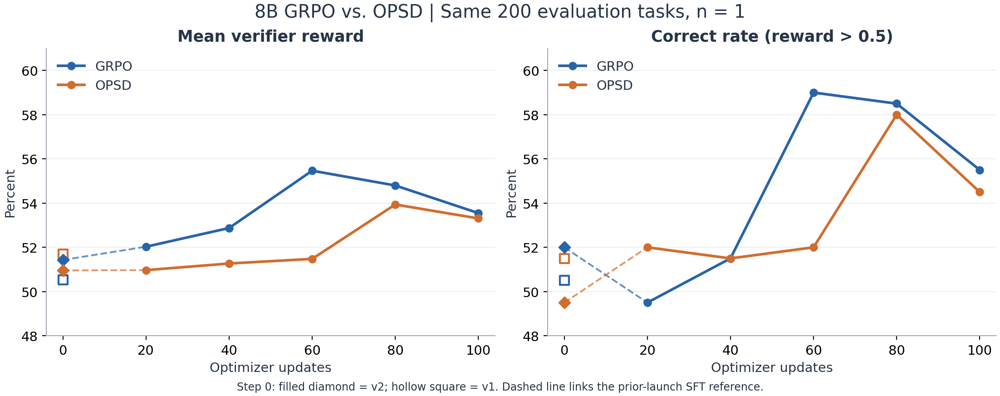
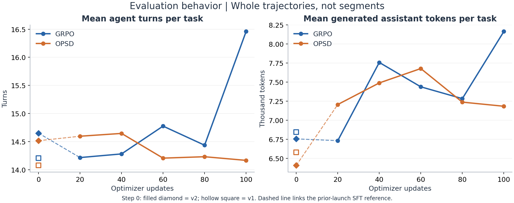

# 8B GRPO / OPSD 对照实验复盘

2026-09-07｜对象：2026-09-04 启动的两组 formal-v3 实验，各训练 100 步。

## 结论

本轮未观察到 OPSD 相对 GRPO 的评测增益。最终平均 reward 为 **53.55% / 53.31%**，OPSD 低 0.24 个百分点；五个评测节点的平均 reward 均低于 GRPO。OPSD 的轨迹并未更长，训练中的切段和步数上限终止反而更少。最值得关注的是：**权重主要表现为对负 advantage 的普遍、小幅放大，尚未体现出明确的动作归因收益。**

## 1. 两种方法与共同配置

**GRPO：以整条任务结果学习。** 同一道题采样 8 条轨迹，由 verifier 给最终 reward；在组内减去均值、除以标准差得到 advantage（A）。高于组内平均的轨迹得到正 A，反之为负。将 A 广播到该轨迹的有效 assistant tokens，用 GRPO／PPO 目标更新；工具结果不参与 loss。

**OPSD：在 GRPO 上增加逐 turn 重加权。** 任务结束后，给 teacher 加入只在训练时可见的 Evidence Anchors，即根据 verifier 整理的任务要求。Teacher 对 student 已生成的各 turn 计算 logprob，与 rollout-old 比较，得到权重 w；负 A 改为 `w × A`，正 A 不变。`w > 1` 加重惩罚，`w < 1` 减轻惩罚。它不是额外做一次 SFT，也不生成或执行修复动作；eval 不注入 anchors。

两组从相同 Qwen3-8B ClawGym SFT 权重开始，每步 8 tasks × 8 samples；每组 2 卡训练、2 卡推理。任务顺序、采样 seed、生成参数及优化配置一致，按逻辑轨迹等权计算 loss。单轮最多 8,192 tokens，上下文 65,536 tokens，最多 96 个 agent turns。

## 2. 评测结果（含 step 0）

| 训练步 | GRPO reward | OPSD reward | OPSD − GRPO | GRPO Correct | OPSD Correct |
|---:|---:|---:|---:|---:|---:|
| 0（v1 重复评测） | 50.53% | 51.69% | — | 50.5% | 51.5% |
| 0（v2 起点参照） | 51.43% | 50.95% | — | 52.0% | 49.5% |
| 20 | 52.03% | 50.97% | −1.06 pp | 49.5% | 52.0% |
| 40 | 52.87% | 51.27% | −1.60 pp | 51.5% | 51.5% |
| 60 | 55.47% | 51.48% | −3.99 pp | 59.0% | 52.0% |
| 80 | 54.80% | 53.94% | −0.86 pp | 58.5% | 58.0% |
| 100 | 53.55% | 53.31% | −0.24 pp | 55.5% | 54.5% |

每次为相同 200 题、每题 1 条轨迹，temperature=0.7、top_p=0.8、top_k=20；含起点共 14 次评测均无缺失。Correct 的代码定义为 **reward > 0.5**，不是全部检查通过率。[含起点的汇总数据](data/eval_with_step0.csv)｜[两次 step 0](data/step0_summary.csv)

step 0 来自此前 v1／v2 启动时、任何更新前保存的完整评测；正式 v3 跳过了起点评测。两组起点权重相同，分数差是重复执行的差异，不是算法效果。图中用最近的 v2 作起点参照，v1 作为重复测量保留；不把它们伪称为 v3 同一次运行内的 step 0。

图 1：左侧为平均 verifier reward，右侧为阈值正确率；均未平滑。step 0 的实心菱形为 v2，空心方形为 v1；虚线表示跨启动的起点参照，20–100 步实线为 v3 正式训练。

以 v2 起点作参照，最终 reward 的观察增量为 GRPO **+2.12 pp**、OPSD **+2.35 pp**；两组都有小幅提高，但跨启动和实时工具环境的波动仍需考虑，不能将差值全部归因于训练。

最终 200 题中，OPSD 高于／低于／等于 GRPO 的题数为 60／63／77。按题配对 bootstrap，平均 reward 差的 95% 区间为 **[−3.37, +2.92] pp**。最终差距不能说明显著优劣；也不能据此认定二者等效。

## 3. 为什么没有看到 OPSD 增益

### 权重更接近负分支缩放，而不是明确的动作归因

实际使用 `delta = mean(logp_teacher_hint − logp_rollout_old)`，负 advantage turn 的 `w = clip(exp(−delta), 0, 1.2)`，训练使用 `w × A`。

重算 100 步保存记录，共覆盖 2,474 条逻辑轨迹、49,979 个已评分 turn：

- **98.75% 的 turn 权重 > 1**，只有 1.25% 被减轻惩罚；79.83% 的被评分轨迹内，所有 turn 都被加重惩罚。
- 按有效 token 加权的平均权重为 **1.0285**；先在轨迹内按 token 平均、再对轨迹等权平均，为 **1.0350**。不是梯度范数分别增加 2.85% 或 3.50%。
- 129–512-token turn 的平均权重为 **1.0434**，超过 2,048-token 的长 turn 为 **1.0208**：长输出的额外调整更弱。[权重分桶](data/opsd_by_turn_length.csv)

同向加权不等于完全没有相对排序作用。但目前证据更支持“小幅加强负分支”，不足以证明它识别了真正导致失败的动作。turn 内先取均值，也可能稀释长代码、长 JSON 中少量关键错误 token 的信号；这仍是待消融验证的解释。

实际记录：`rollout_99 / task_0983` 某条轨迹的 A=−2.4749，前三个 turn 的 w 分别为 1.0376、1.0390、1.0378，对应 A 约为 −2.5679、−2.5713、−2.5685，基本是同幅度加重惩罚。[原始数值摘录](data/opsd_turn_weights.csv)

### 不是“OPSD 轨迹更长、pruning 更多”

| 指标与口径 | GRPO | OPSD |
|---|---:|---:|
| 全程训练：平均 agent turns／轨迹 | 20.32 | 19.25 |
| 全程训练：agent turns P90 | 59 | 53 |
| 全程训练：平均 segments／轨迹 | 2.69 | 2.36 |
| 全程训练：96-turn 上限终止 | 334／6,395（5.22%） | 260／6,397（4.06%） |
| 全程训练：未闭合工具调用因长度上限终止 | 200（3.13%） | 210（3.28%） |
| 最终 eval：平均 agent turns／题 | 16.46 | 14.17 |
| 最终 eval：累计 assistant tokens／题 | 8,165 | 7,184 |
| 最终 eval：至少一轮命中生成长度上限 | 2／200 | 8／200 |

训练分母为实际提交轨迹；长度按整条评测轨迹累计，不包含 prompt／工具结果，不重复计算 segment 前缀。[训练统计](data/train_trajectory_headers.csv)｜[逐题长度](data/eval_task_metrics.csv)

图 2：同一批 200 题的平均交互轮数与累计生成量，包含两次 step 0，标记含义与图 1 相同。最终 OPSD 比 GRPO 少用约 14% 的轮数、12% 的 tokens，但没有转化为更高 reward；单轮截断问题仍存在。

两个同题例子说明，平均变短并不等于质量提高：

- **task_0162，商品盈亏平衡分析**：GRPO 8 轮、reward=1.00；OPSD 3 轮即结束，reward=0.25。
- **task_0164，文本与邮件脱敏**：GRPO 4 轮、reward=0.6429；OPSD 第 3 轮生成 8,192 tokens，`finish_reason=length`，工具调用未闭合，reward=0。[案例依据](证据与口径.md#真实案例)

### 训练 reward 的改善没有转化为评测优势

末 20 步 submitted reward 为 GRPO **0.6592**、OPSD **0.6736**，但最终 eval 基本持平。训练 reward 较高不等于泛化更好，也不能单凭此判定 reward hacking。

OPSD 在进入统计的 2,513 条负 advantage 轨迹中成功应用于 2,474 条（98.45%），不是大面积回退导致算法未生效。两组裁剪后梯度范数均未超过 1；最近一次记录的 SFT-reference KL 分别为 0.00203、0.00152，不支持“完全没有更新”的解释。

## 4. 判断与后续验证

本轮可下的结论是：**现有绝对 logprob 差加权没有带来可见的评测收益，减少交互与切段也没有解决关键输出失败。** 不能仅凭这些观察确定单一原因，更不能推广为所有 OPSD 方法无效。

优先验证两点：① 用匹配的无 hint 评分对照，区分提示／评分口径的整体偏移与真正的动作信息；② 与等强度、统一放大负 advantage 的基线比较，检验收益究竟来自逐 turn 归因，还是整体惩罚强度。未经这些对照，不宜把负 delta 直接解释为“该动作做错了”。

---

附：[证据口径、源码与复算方法](证据与口径.md)。压缩包保留图表、逐题／逐 turn 数值和 CPU 分析脚本；不含权重、密钥或原始 workspace。
