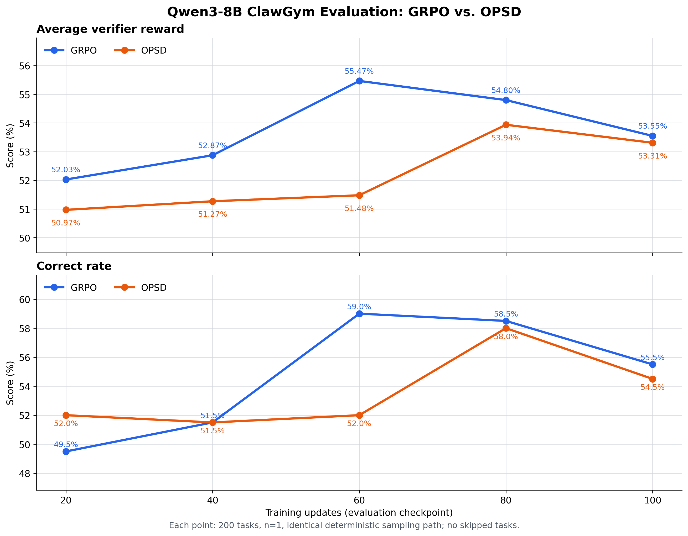

# OpenClaw/ClawGym Agent 训练阶段工作总结

**时间范围：** 2026 年 8 月—9 月 7 日  
**代码仓库：** `/root/openclaw-rl-local`  
**总结口径：** 截至提交 `1649f3a9`；当前 Verified Repair v3 的接口修复均已提交，端到端 smoke 仍在验证，因此不计为已完成成果。

## 一、执行摘要

本阶段的核心工作不是简单“跑完一次 RL”，而是先把 OpenClaw 多轮工具轨迹可靠地转换为可训练、可复现、可审计的策略梯度样本，再系统判断不同信用分配方法是否真正有效。

目前可以得出五个清晰结论：

1. **OpenClaw RL 的关键训练语义已经基本修正。** 上下文重写、tool-result pruning、compaction、多工具调用和跨 segment loss 等问题均已有明确处理，训练所使用的 token、上下文与 rollout logprob 能够保持一致。
2. **训练侧数值不确定性已经解决，跨训推后端误差得到明显缓解。** Megatron 重复计算可做到逐元素一致；routing replay 将 SGLang–Megatron 的 logprob MAE 降低约 49%，TIS 的有效样本量仍保持在 99.7% 以上。
3. **SFT 收益明确，普通 RL 收益尚不稳定。** 在固定 200 题协议下，30B SFT 相比基模 reward 提升约 12 个百分点、正确率提升 17 个百分点；30B RL 独立复评尚不能证明稳定超过 SFT。
4. **原始 Evidence-Anchor OPSD 未表现出稳定优势。** 8B 的标准 GRPO 与 OPSD 最终评测接近，GRPO 的中途峰值反而更高；后续 centered 和 matched-placebo 诊断揭示了信用方向错误与 teacher 信号不可辨识问题，均按预设门槛停止。
5. **Verified Action Repair 是当前更合理、但尚未通过数据门槛的研究方向。** v2 已证明整套恢复、回放和验证链路可工作，但 64 条轨迹最终只有 1 条形成严格有效修复，故没有启动训练；v3 正在改造为“选择错误决策点—重放真实前缀—执行完整剩余预算—验证最终增益”。

| 工作模块 | 当前状态 | 核心结论 |
|---|---|---|
| OpenClaw RL 训练语义 | 已完成并验证 | 可正确训练上下文重写和多 segment 轨迹 |
| 多工具调用 | 已完成并验证 | 不再只执行第一个 tool call |
| 训练确定性 | 已完成并验证 | 相同数据、相同权重两次 Megatron forward/backward 一致 |
| Routing replay + TIS | 已完成并 smoke | 显著降低跨后端 mismatch，代价可控 |
| 固定协议评测 | 已完成 | checkpoint 间可使用相同逐题 seed 比较 |
| 30B GRPO | 已完成 | 稳定训练，但独立复评未显示稳定总体增益 |
| 8B GRPO vs OPSD | 已完成 | 两者均较 SFT 有改善迹象，OPSD 未优于 GRPO |
| Centered / Placebo OPSD | Phase-0 已完成 | 均触发 NO-GO 条件 |
| Verified Repair v2 | 已完成 | 工程链路通过，合格数据覆盖率不足，未训练 |
| Verified Repair v3 | 进行中 | 仍处于接口与候选生成诊断阶段 |

## 二、问题背景

ClawGym 任务不是单轮问答。模型需要在最长 65,536-token 的实时上下文中反复调用文件、终端、进程和网络工具，并依据工具结果继续决策。OpenClaw 还会动态裁剪过长的工具结果、重写消息历史并执行上下文压缩。

这带来三个不同层面的问题：

- **训练正确性：** rollout 时真正看到的上下文，是否与训练 loss 中的上下文完全相同；
- **系统稳定性：** SGLang 生成侧与 Megatron 训练侧是否给同一 token 相近的概率和 MoE 路由；
- **信用分配：** 一条最终失败的长轨迹中，哪些动作值得保留，哪些动作应受到惩罚。

本阶段按上述顺序推进。先解决前两项，避免把基础设施误差误判为算法效果；随后才比较 GRPO、OPSD 和 verified repair 类方法。

## 三、训练链路的主要代码改造

### 3.1 正确处理 pruning 与 compaction

旧实现默认下一轮 prompt 只是上一轮 prompt 的追加：先计算最长公共前缀，再把新 token 拼到旧序列后面。但 OpenClaw 的 tool-result pruning 和 compaction 会**重写历史**，此时继续拼接会构造出模型从未真实看到过的“伪上下文”。

现实现采用严格规则：

- prompt 仅追加时，继续当前 segment；
- 历史发生重写时，结束原 segment；
- 从 SGLang 实际接收的新 prompt 原样重新 tokenize，建立新 segment；
- 只对模型真实生成的 assistant response token 设置 loss mask；
- summary、工具结果、系统消息和用户消息不参与策略 loss。

由此维持以下不变量：

> 生成 token 的真实前缀 = rollout logprob 的条件前缀 = Megatron 训练该 token 时的条件前缀。

关键提交：`031c4738`、`70ee3fe5`、`6486ffd4`。

### 3.2 支持一轮多个工具调用

旧 Proxy 会解析模型输出中的多个 `<tool_call>`，但只执行和保留第一个。SFT 数据中多工具 assistant turn 并不少见，这会造成明显的交互协议错位。

改造后：

- 按出现顺序解析全部合法 tool call；
- 为每个调用生成唯一 ID；
- 依次执行并回传对应的 tool result；
- 保留完整模型原始输出及审计信息。

正式训练中工具返回保留率达到 100%；部分 rollout 中多工具 turn 占比约 12.5%。关键提交：`ecba8996`。

### 3.3 分离 agent 请求和压缩请求

OpenClaw 的 compaction summary 也会请求模型，但它不是策略的一次 agent action。现实现使用独立模型 ID 和 ledger 区分：

- main agent response：进入策略轨迹并计算 loss；
- compaction response：只改变下一轮可见上下文，不作为策略动作训练；
- heartbeat 和后台完成通知被关闭，显式 `process` polling 仍保留。

这避免了把系统维护请求误记为 agent step。

### 3.4 按“逻辑轨迹”等权计算 loss

同一条长轨迹可能因 pruning/compaction 被拆成多个训练 segment。如果直接把 segment 当作独立样本，重写次数多的轨迹会获得更大权重。

现实现保留统一的 task、sample 和 logical-rollout identity：

- reward 和 group advantage 在完整逻辑轨迹层面计算；
- advantage 广播到该轨迹的所有有效 assistant token；
- 各 segment 的 token loss 先在逻辑轨迹内部归一化；
- 再在 batch 中对逻辑轨迹等权平均。

因此，一条轨迹拆成 1 个或 10 个 segment，不会仅因 segment 数量增加而扩大总 loss mass。关键提交：`8b9915ee`。

### 3.5 长轨迹保护和可观测性

正式配置统一为：

| 限制 | 数值 | 作用 |
|---|---:|---|
| 单轮 response | 8,192 tokens | 限制一次 assistant 生成 |
| live context | 65,536 tokens | 限制模型一次实际可见上下文 |
| 累计 assistant tokens | 65,536 | 限制整条任务总生成预算 |
| agent steps | 96 | 限制工具交互轮数 |
| compaction events | 8 | 限制反复压缩 |
| outer timeout | 1,200 s | 防止单轨迹无限占用资源 |

达到长度或步数限制、但 verifier 仍可评分的轨迹继续作为真实失败样本训练，不因低 reward 被过滤。新增监控覆盖结束原因、response 截断、未闭合工具调用、重复退化、pruning/compaction、pre/post-clip gradient norm 和工具错误。

## 四、训推一致性与数值稳定性

### 4.1 训练侧重复计算

在 MoE 30B 模型上，默认配置下，相同权重与相同 batch 的两次完整梯度 cosine similarity 仅为：

```text
0.560984 / 0.684099 / 0.460590
```

Dense Qwen3-0.6B 对照为 `0.999914`，说明主要问题来自 MoE 路由及并行数值路径，而不是数据重新 tokenize。

启用 Megatron 确定性配置后，在 30,532,122,624 个分布式 FP32 master-gradient 元素和 84,432 个有效 token logprob 上实现：

- gradient cosine similarity = `1.0`；
- relative L2 error = `0`；
- logprob 逐元素一致。

代价是纯 forward/backward 阶段约增加 30%–38% 耗时。该代价换取的是可解释的 PPO old/current ratio，而非随机路由造成的伪策略更新。

### 4.2 SGLang–Megatron 跨后端误差

即使训练侧完全确定，SGLang rollout 与 Megatron teacher-forcing 仍不可能天然逐元素一致。确定性 Megatron 条件下，84,432 个 token 的结果为：

| 指标 | 数值 |
|---|---:|
| logprob MAE | 0.008204 |
| P50 / P90 / P95 / P99 绝对误差 | 3.58e-7 / 0.00642 / 0.04294 / 0.19961 |
| 平均绝对 probability-ratio 误差 | 0.7995% |
| `abs(ratio-1) > 1%` | 8.937% |
| `abs(ratio-1) > 5%` | 4.544% |
| `abs(ratio-1) > 10%` | 2.505% |

误差并非均匀分布：最低概率的 10% token 承担约 97% 的绝对 logprob 误差和超过 99.8% 的平方误差。因此“平均 MAE 约 0.01”不能解释为“99% token 一致”。

### 4.3 Routing replay 与 TIS

Routing replay 保存 rollout 时的 MoE expert 路由，并在 Megatron 重算 logprob 时复用；TIS 则使用 rollout/训练概率比校正剩余的跨后端 mismatch。

| 指标 | 不回放 | 完整 routing replay | 改善 |
|---|---:|---:|---:|
| logprob MAE | 0.013308 | 0.006784 | -49.0% |
| logprob RMS | 0.062910 | 0.025230 | -59.9% |
| P99 logprob 误差 | 0.232825 | 0.119062 | -48.9% |
| 最大 logprob 误差 | 3.1765 | 0.5783 | -81.8% |
| ratio 超出 `[0.8, 1.28]` | 1.0228% | 0.1355% | -86.8% |

TIS `[0,2]` 的一次受控测试中：

- mean weight = `0.999712`；
- effective sample size = `99.7454%`；
- 14,763 个 token 仅 1 个触发裁剪；
- gradient norm 相比不校正仅变化约 `-0.5%`。

这说明 TIS 在当前 BF16 配置下主要修正长尾 token，并未显著降低有效训练数据量。

### 4.4 Route stitching 的性能收益

逐 turn 保存 routing replay 会把一条长轨迹切成大量 segment。后续实现仅在上下文重写或真实 route conflict 时切分，其余 turn 安全拼接。

一次 64 轨迹正式 smoke 的结果：

| 指标 | 改造前 | 改造后 | 变化 |
|---|---:|---:|---:|
| 训练 segment | 870 | 132 | -84.83% |
| 上下文 token | 13.53M | 2.49M | -81.60% |
| micro-batch | 170 | 32 | -81.18% |
| rollout dump | 20.883 GB | 3.847 GB | -81.58% |
| 训练侧时间 | 1,917.6 s | 442.7 s | -76.91% |
| wait + train | 3,087.9 s | 1,535.6 s | -50.27% |

该 smoke 中 738 个 turn 被安全拼接，未出现轨迹丢失；353,402 个 response token 的 MAE 为 `0.008662`，TIS ESS 为 `99.8981%`。

## 五、模型训练与评测结果

### 5.1 SFT 数据与监督口径

8B SFT 使用 OpenClaw 2026.4.1 生成的多轮轨迹。预处理后：

- 原始轨迹：22,631；
- 超过 65,536 tokens 后过滤：3；
- 最终轨迹：22,628；
- assistant spans：237,363；
- 总长度 P50/P90/P95/P99/Max：15,128 / 26,286 / 33,034 / 47,481 / 65,430 tokens；
- loss 仅覆盖 assistant 文本和 tool calls；system、user 和 tool results 只作为条件上下文；
- 当前六工具环境不支持的 `browser` 样本已过滤。

### 5.2 30B Base 与 SFT

固定 200 题、`n=1`、temperature `0.7`、top-p `0.8`、top-k `20`、统一逐题 sampling seed 的对照结果：

| 模型 | 平均 reward | Correct | 零 reward |
|---|---:|---:|---:|
| Qwen3-30B-A3B Base | 0.41477 | 83/200（41.5%） | 32 |
| ClawGym SFT | 0.53455 | 117/200（58.5%） | 9 |
| 提升 | **+0.11978** | **+17.0 pp** | **-23** |

逐题比较为 108 胜、47 平、45 负；bootstrap 95% CI 为 `[0.0810, 0.1599]`，Correct 状态转移的 McNemar exact test 为 `p=5.85e-5`。因此，**SFT 带来的能力提升是本阶段最明确的模型效果结论。**

### 5.3 30B GRPO

正式训练稳定完成约 100 个 rollout step、99 次 optimizer update，无持续性 reward collapse、NaN 或 OOM。

训练内在线 eval：

| Step | 19 | 39 | 59 | 79 | 99 |
|---|---:|---:|---:|---:|---:|
| Reward | 55.21% | 54.94% | 56.29% | 57.23% | 57.63% |
| Correct | 59.0% | 57.5% | 61.0% | 61.5% | 63.0% |

但同一 checkpoint 的三次独立复评均值为：

| Step | 19 | 39 | 59 | 79 | 99 |
|---|---:|---:|---:|---:|---:|
| Reward 均值 | 54.72% | 54.93% | 54.05% | 54.94% | 54.64% |
| 标准差 | 1.08 | 0.89 | 0.74 | 1.50 | 1.09 |

历史 SFT 基线约为 55.00%。因此在线 eval 的上升不能单独证明 RL 改善；更严谨的结论是：

> 30B GRPO 已实现稳定、可训练的策略更新，并减少了部分退化行为，但在 200 题、`n=1` 的独立复评下，尚无稳定超过 SFT 的总体 reward 证据。

行为侧仍观察到一些积极变化：前 50 step 到后 50 step，重复退化率下降 27.5%，response-limit 命中下降 15.9%，长度上限处未闭合 tool call 下降 16.6%。但 submitted reward 基本持平，平均 agent steps 从 17.63 增至 19.51，说明模型变得更少退化，却未必更高效或更准确。

### 5.4 8B GRPO 与 Evidence-Anchor OPSD

两组均从相同 8B SFT 起点训练，使用相同任务顺序、sampling seed、生成参数和优化器配置；每步 `8 tasks × 8 samples`，评测采用相同 200 题确定性路径。

| Step | GRPO reward | OPSD reward | GRPO Correct | OPSD Correct |
|---|---:|---:|---:|---:|
| 20 | 52.03% | 50.97% | 49.5% | 52.0% |
| 40 | 52.87% | 51.27% | 51.5% | 51.5% |
| 60 | **55.47%** | 51.48% | **59.0%** | 52.0% |
| 80 | 54.80% | **53.94%** | 58.5% | 58.0% |
| 100 | 53.55% | 53.31% | 55.5% | 54.5% |

校正后的 8B SFT 单次评测为 reward `0.49551`、Correct `94/200`。不同 run 间仍需严格确认完全相同的逐题 seed，因此这里只能说两种 RL 都有改善迹象；**同一 RL 配对实验内部，Evidence-Anchor OPSD 没有显示出相对标准 GRPO 的优势。**



## 六、Agent 信用分配研究

### 6.1 为什么需要超越轨迹级 GRPO

ClawGym 的 reward 主要来自最终 workspace 和 verifier。一条失败轨迹中可能同时包含：

- 正确的文件读取和环境诊断；
- 有价值但未完成的中间修改；
- 真正导致失败的错误 action；
- 基础设施或网络噪声；
- 失败后的恢复尝试。

把同一个负 advantage 广播给整条轨迹，会同时惩罚合理动作。离线审计也证明该数据具备细粒度信用分配空间：500 个抽样任务均有稳定的 factorized verifier；同策略 sibling rollout 中，大量 task group 同时包含不同 criterion 的成败组合。

### 6.2 Evidence-Anchor OPSD：方向可用，但信号有偏

原方案根据 verifier criterion 生成静态 Evidence Anchors，并比较同一 student action 在“有 hint”和“无 hint”条件下的 logprob，以重加权负 advantage turn。

早期训练中 teacher 差值约 98.6% 为负，主要效果是加重失败惩罚，而不是保护合理动作。完整 8B 对照最终也没有优于 GRPO。

结论：Evidence Anchors 能为 teacher 提供任务约束，但“hint 是否提高原错误 action 的概率”并不等价于“该 action 是否应获得更少惩罚”。

### 6.3 Centered OPSD：离线门槛失败

Centered OPSD 在每条轨迹内部用 median/MAD 对 teacher 差值中心化，试图消除轨迹级偏置。离线重算覆盖：

- 2,474 条负 advantage 逻辑轨迹；
- 6,739 个 segment；
- 49,979 个 assistant step。

数值实现稳定，但严格匹配数据上出现方向性反例：tool parse failure、重复调用、重复退化和未闭合 tool call 的平均权重均小于 1，即算法反而减轻了对这些明显错误的惩罚。因此按 Phase-0 门槛停止，没有继续训练 100 step。

### 6.4 Matched-Placebo OPSD：teacher 差值不可辨识

该实验为每个真实 anchor 配置 3 个长度和格式匹配、但与任务无关的 placebo anchor，检验 teacher 差值究竟来自语义证据还是 prompt 扰动。

30 条轨迹、399 个 turn、1,596 次 teacher score 的结果：

- K=3 符号翻转率：47.37%；
- `abs(delta) >= 0.005` 时翻转率：34.66%；
- `abs(delta) >= 0.01` 时翻转率：16.90%；
- 三个 placebo 间 Pearson：0.7277–0.7629；
- 好/坏动作类别均值差：0.000432，bootstrap CI `[-0.001454, 0.003532]`。

真实与 placebo anchor 产生的权重强度接近，但没有稳定、可用的方向差异，故结论为 **NO-GO**。

### 6.5 Verified Action Repair：从“解释错误”转向“验证替代动作”

新的核心思路是：不要仅让 teacher 判断原 action 好坏，而是在 student 的真实决策快照上生成一个可执行修复，真实执行并继续完成任务；只有修复后的最终 verifier 分数严格提高，才把该修复动作作为监督目标。

v2 pilot 已完成完整工程验证：

- 64/64 个决策快照有效；
- 136/136 个分支成功恢复 workspace；
- 68/68 个原关键 tool action 可重放；
- 128 个 action、80,237 个 token 完成 span 对齐；
- 无基础设施失败、恢复失败或 timeout。

但数据门槛没有通过：

- 初始配对验证仅 4/64 有增益；
- 第二 seed 复验后只剩 2/4；
- 信息边界审计后最终仅 1/64（1.56%）为严格有效修复；
- 46 个候选没有严格改善，16 个出现 criterion regression，1 个使用了当前状态下不可得的信息；
- 唯一接受样本中可施加 margin 的位置主要是 analysis token，尚未证明能修复工具 action。

因此 v2 按规则停止，**没有用极少量高偏样本做 optimizer update**。这是有价值的负结果：它否定了“teacher 给一个局部修复即可形成可靠 action-level supervision”的简单假设。

v3 正在验证更严格的方案：teacher 先选择错误决策点；系统从记录前缀恢复；执行修复 action；给予与原轨迹相同的剩余预算；最后以完整 verifier 比较决定是否接收。当前仍处于候选生成和 reviewer 接口诊断，不应表述为已验证算法。

## 七、可复用的工程与研究资产

### 7.1 关键代码

| 功能 | 文件 |
|---|---|
| OpenClaw Proxy、消息 ledger、上下文重写 | [clawgym_rl_api_server.py](/root/openclaw-rl-local/clawgym-official/clawgym_rl_api_server.py) |
| rollout、logical trajectory 与远端容器调度 | [clawgym_rl_rollout.py](/root/openclaw-rl-local/clawgym-official/clawgym_rl_rollout.py) |
| 30B 正式训练入口 | [run_qwen3_30b_a3b_official_remote_grpo.sh](/root/openclaw-rl-local/clawgym-official/run_qwen3_30b_a3b_official_remote_grpo.sh) |
| GRPO/logical-rollout loss | [loss.py](/root/openclaw-rl-local/slime/slime/backends/megatron_utils/loss.py) |
| OPSD 权重逻辑 | [opsd_utils.py](/root/openclaw-rl-local/slime/slime/utils/opsd_utils.py) |
| session affinity 路由 | [router.py](/root/openclaw-rl-local/slime/slime/router/router.py) |
| MoE routing replay | [routing_replay.py](/root/openclaw-rl-local/slime/slime/utils/routing_replay.py) |
| 8B 双组训练入口 | [run_qwen3_8b_dual_arm_20260904.sh](/root/openclaw-rl-local/scripts/run_qwen3_8b_dual_arm_20260904.sh) |
| Verified Repair teacher/reviewer | [verified_repair_teacher.py](/root/openclaw-rl-local/scripts/verified_repair_teacher.py) |
| Verified Repair replay pilot | [run_verified_repair_replay_pilot.py](/root/openclaw-rl-local/scripts/run_verified_repair_replay_pilot.py) |

### 7.2 关键提交

| 提交 | 内容 |
|---|---|
| `031c4738` | 正确切分被重写的 rollout context |
| `70ee3fe5` | 使用 SGLang 真实 response tokens/logprobs 训练 |
| `ecba8996` | 执行并保留全部 tool calls |
| `6486ffd4` | 上下文、compaction 和诊断体系整合 |
| `6267056e` | 确定性 routing/eval 与 session affinity |
| `97188535` | 长 segment packing 优化 |
| `9c99a5d4` | 稳定训练栈阶段快照 |
| `8b9915ee` | logical-rollout 等权 loss |
| `302d35d3` | segment-safe OPSD weighting |
| `11d00306` | 8B GRPO/OPSD 隔离训练 |
| `d4e55754` | Centered OPSD 与 SDAR 诊断 |
| `b8786454` | Matched-placebo OPSD |
| `4c38307f` | Recorded-prefix Verified Repair v3 基础设施 |

### 7.3 原始报告

- [训练/推理数值稳定性总审计](/root/openclaw-rl-local/reports/OPENCLAW_RL_TRAIN_INFERENCE_STABILITY_REVIEW_20260825_ZH.md)
- [Routing replay stitching 正式 smoke](/root/openclaw-rl-local/reports/FORMAL_ROUTING_REPLAY_STITCH_SMOKE_STEP99_20260825_ZH.md)
- [30B Base 与 SFT 固定协议评测](/root/openclaw-rl-local/reports/BASE_VS_SFT_DETERMINISTIC_EVAL_20260820_ZH.md)
- [8B SFT 数据与训练预检](/root/openclaw-rl-local/reports/CLAWGYM_8B_SFT_PREFLIGHT_20260902_ZH.md)
- [OPSD 正式实验简报](/root/openclaw-rl-local/reports/OPSD_FORMAL_EXPERIMENT_BRIEF_20260901_ZH.md)
- [Centered OPSD Phase-0](/root/openclaw-rl-local/reports/CENTERED_OPSD_PHASE0_DIAGNOSTIC_20260906_ZH.md)
- [Matched-placebo OPSD Phase-0](/root/openclaw-rl-local/reports/MATCHED_PLACEBO_OPSD_PHASE0_GATE_20260906_ZH.md)
- [Verified Action Repair 方案](/root/openclaw-rl-local/reports/VERIFIED_ACTION_REPAIR_MARGIN_PLAN_20260907_ZH.md)
- [Verified Action Repair v2 结果](/root/openclaw-rl-local/reports/VERIFIED_ACTION_REPAIR_MARGIN_RESULT_20260907_ZH.md)
- [Verified Repair Replay v3 执行记录](/root/openclaw-rl-local/reports/VERIFIED_REPAIR_REPLAY_V3_EXECUTION_ZH.md)
- [ClawGym verifier/OPD 预检](/root/openclaw-rl-local/research/ClawGym_OPD_Precheck_Result_20260831_ZH.md)

## 八、本阶段的实际贡献

从工程角度，本阶段把一个容易发生“训练上下文与真实执行上下文不一致”的黑盒 agent harness，改造成了具备以下性质的实验平台：

- 多轮 token 前缀可追溯；
- context rewrite 可安全训练；
- multi-tool 语义与 SFT 对齐；
- logical rollout 权重不受 segment 数量影响；
- MoE 训练计算可确定复现；
- 跨后端误差可测量、可回放、可校正；
- checkpoint 评测可使用固定逐题随机路径；
- verifier、最终 workspace 和完整轨迹可归档审计。

从研究角度，本阶段不仅得到正结果，也建立了有效的 **Phase-0 一票否决流程**：先验证信用信号的方向、稳定性、覆盖率和可执行性，再决定是否投入 100-step 训练。Centered OPSD、matched-placebo OPSD 和 Verified Repair v2 都因明确证据被及时停止，避免将计算预算消耗在不可辨识或覆盖率过低的信号上。

## 九、当前边界与下一步

### 已经能够稳定支持的工作

- 从 SFT checkpoint 启动 8B/30B 多轮工具 RL；
- 使用 routing replay、TIS 和 logical-rollout loss；
- 固定逐题 seed 复评任意 checkpoint；
- 保存完整轨迹、verifier 结果和 workspace；
- 对新信用分配方法先做不更新参数的离线或 replay gate。

### 尚不能宣称的结论

- 不能宣称 30B GRPO 已稳定超过 SFT；
- 不能宣称 Evidence-Anchor OPSD 优于普通 GRPO；
- 不能把单次在线 eval 峰值当作可复现提升；
- 不能宣称 Verified Repair 已形成有效训练算法；v3 尚在验证。

### 建议后续优先级

1. **完成 Verified Repair v3 的小规模 gate。** 先证明至少覆盖 16 个有效 repair pair、8 个不同任务，且训练集与 held-out seed 都保持严格增益；否则停止该路线。
2. **补齐严格配对的 8B 基线。** 对 SFT、GRPO-100 和 OPSD-100 使用完全相同任务、逐题 seed、工具环境和 verifier，多 seed 报告均值与置信区间。
3. **若 v3 通过，再比较监督目标。** 在相同 verified repair pairs 上比较 action NLL、pairwise preference，以及“preference + 首个采样障碍 margin”；只改变 loss，不同时改变数据。
4. **把系统稳定性作为固定底座。** 后续算法实验继续保持确定性 Megatron、session affinity、routing replay、TIS、logical-rollout normalization 和固定 eval 协议，不再重复引入系统变量。

## 十、最终结论

本阶段最重要的成果，是把 OpenClaw/ClawGym 的长上下文、多工具、多 segment Agent RL 从“可以运行”推进到“训练语义正确、数值误差可解释、评测能够审计”。模型层面，SFT 的提升明确；普通 GRPO 能稳定更新并减少部分退化行为，但总体收益仍受评测方差和信用分配粗糙的限制。

原始 OPSD 路线没有得到预期收益，后续实验进一步定位到两个根因：**hint-conditioned logprob 差值不稳定地代表动作质量，且局部 teacher 建议不一定能在真实环境中形成最终改善。** 因而下一阶段的研究重点应从“让 teacher 解释失败”转向“让 teacher 提出可执行替代动作，并用真实环境和最终 verifier 验证其因果价值”。这一方向更符合 Agent 任务的状态依赖性，也为新的 action-level credit assignment 方法提供了清晰、可证伪的研究路径。
