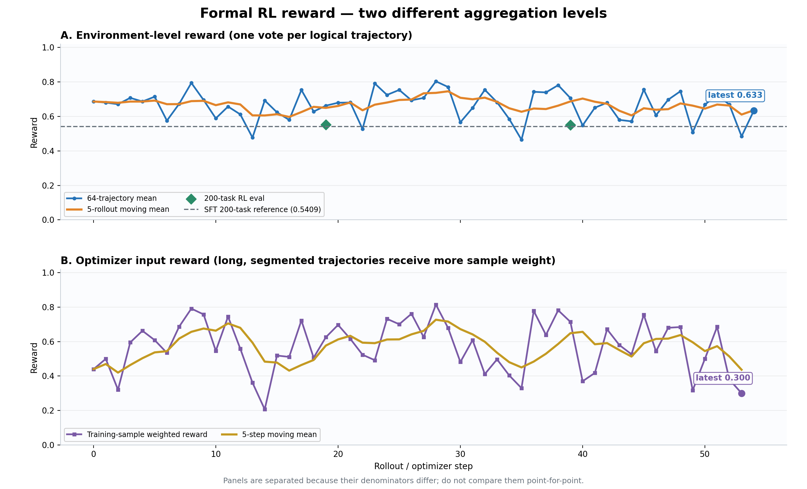
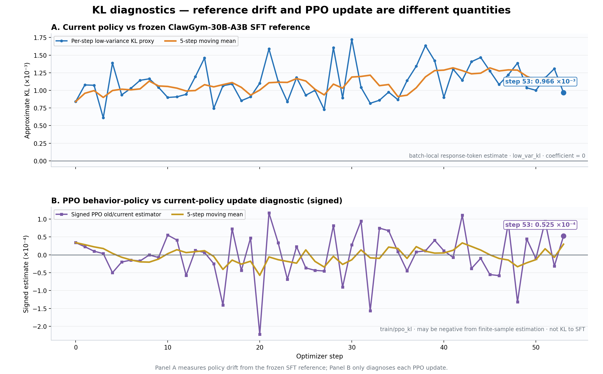
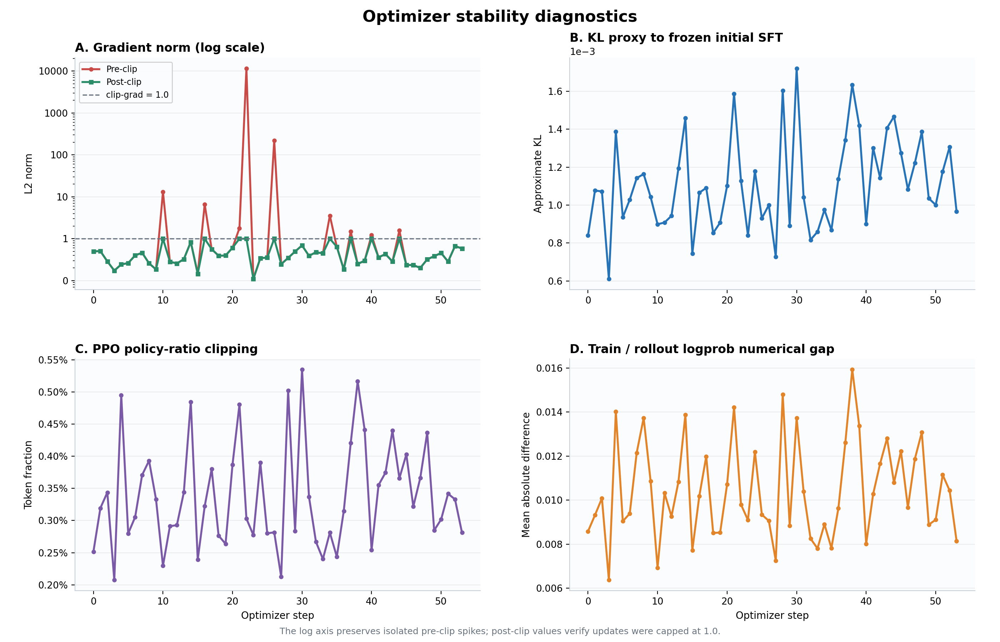
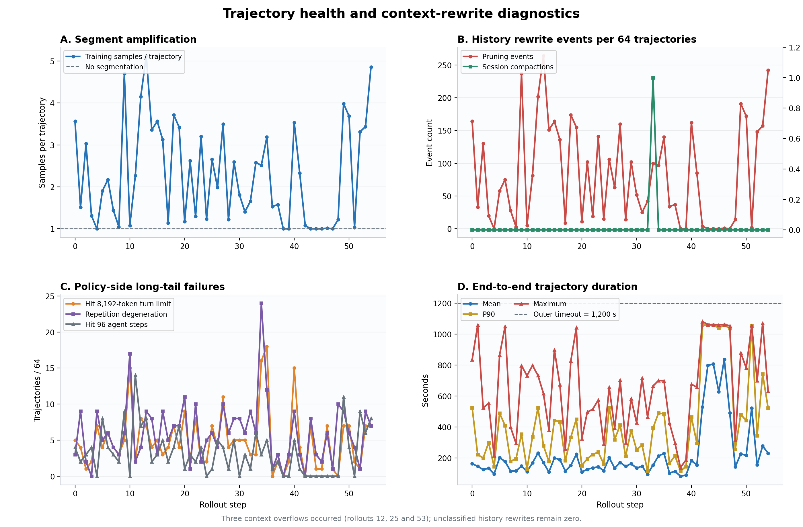

# OpenClaw-RL 本地迁移与正式训练稳定性改造汇报

> 版本：2026-08-11 00:50（CST）  
> 数据截面：rollout 0–54 已完成采集、optimizer step 0–52 已完成；step 53 正在计算。  
> 独立工作区：`/root/openclaw-rl-local`。共享盘原始内容未删除、未原地修改。

## 一、结论

本轮完成了 OpenClaw-RL 从共享挂载盘到本机隔离工作区的迁移，并修复三项会直接破坏 RL 训练语义的问题：

1. pruning/compaction 重写上下文后，旧实现仍按原前缀拼 token，导致 prompt、logprob 与 loss 上下文错配；
2. assistant 一次输出多个 tool call 时，旧 Proxy 只执行第一个；
3. OpenClaw 的压缩总结请求与主 agent 请求共用模型 ID，summary 可能被误记为策略 action。

改造后，正式训练已稳定完成 optimizer step 52，rollout 0–54 计划执行 **3,520 条轨迹**，其中 **3,518 条正常提交、2 条进入跳过/恢复流程（1 条恢复、1 条丢失）**。没有 OOM、NCCL/Ray 致命错误、NaN/Inf 或训练进程崩溃。完整 checkpoint `iter_0000019`、`iter_0000039` 均已落盘；对应两轮 200 题 eval 全部回收，平均 verifier reward 分别为 **0.5521 / 0.5494**，correct rate 为 **59.0% / 57.5%**。

当前可以确认：**训练闭环已恢复可信，正式训练稳定推进；但训练尚未完成，不能据此宣称模型已经收敛。**

## 二、已落地改造

| 模块 | 原问题 | 处理与验证 |
|---|---|---|
| 本地隔离 | `/mnt` 是共享盘，代码可能被其他任务改动 | 完整迁移到 `/root/openclaw-rl-local`，移除旧链接依赖；共享盘原文件保留 |
| 精确 token ledger | 上下文重写后仍强行拼接旧 token | 保存 SGLang 实际 response token/logprob；仅严格 append-only 时续接 |
| 上下文重写切分 | pruning、compaction、system prompt 变化会改变前缀 | 分类重写类型并开启新训练 segment；未分类历史重写累计为 0 |
| 压缩请求隔离 | summary 可能进入主策略轨迹 | 主请求与 compact 请求使用独立模型 ID 和 ledger |
| 多工具调用 | 旧 Proxy 只执行第一个调用 | 解析、执行并返回全部调用，以 tool-call ID 关联结果；返回 retention 全程 100% |
| 后台辅助请求 | heartbeat/process completion 改变交互分布 | 关闭 heartbeat，设置 `exec.notifyOnExit=false`；模型仍可主动 poll |
| 运行边界 | 极端长尾拖慢整个 batch | response 8,192、live context 65,536、assistant token 65,536、agent step 96、compaction 8、外层 timeout 1,200 秒 |
| 联网能力 | Serper 变量名与注入不一致 | 对齐 `SERPER_API_KEY`，只注入消费凭据的容器；不打印、不归档 `.env` |
| 训练监控 | 无法区分截断、重复和梯度裁剪 | 增加结束原因、未闭合工具调用、重复退化、历史重写、pre/post clip 等指标 |
| eval/checkpoint | 缺少稳定恢复点 | 每 20 step eval 并保存完整 checkpoint；本地余量不足 500 GB 时回退专用 `/mnt` 目录 |

主要改造提交：`031c4738`、`70ee3fe5`、`ecba8996`、`72e82c12`、`d534d7df`、`6486ffd4`、`10d6097b`。

## 三、正式训练配置

- 模型：Qwen3-30B-A3B MoE，ClawGym SFT checkpoint 起训。
- 算法：GRPO，learning rate `1e-6`；`eps_clip=0.20`、`eps_clip_high=0.28`，正式训练移除 `eps_clip_c`。
- 拓扑：GPU 0–3 为 Megatron actor；GPU 4–7 为 SGLang rollout。
- rollout：2 个 engine，每个 tensor parallel=2；worker=32。
- 每轮：8 个任务 × 每题 8 条 = 64 条逻辑轨迹。
- 稳定性：`clip-grad=1.0`、sequence parallel、动态 batching、per-token loss、optimizer CPU offload。
- 调度：seed=0；每 20 step eval；每 20 step 保存完整 checkpoint。

## 四、阶段性结果

### 4.1 Reward



图中两个面板分母不同：

- `avg_reward_submitted`：每条逻辑轨迹等权，反映环境层表现；
- `raw_reward`：按切分后的训练 sample 聚合，长轨迹权重更高，接近 optimizer 实际输入。

| 指标 | 数值 |
|---|---:|
| 55 个 rollout 的轨迹平均 reward | 0.6634 |
| 最新 rollout 54 | 0.6333 |
| 最近 5 个 rollout 均值 | 0.6360 |
| step 0–53 训练 sample 加权 raw reward 均值 | 0.5720 |
| 最新已写入的 step 53 raw reward | 0.3000 |
| 原始 SFT 200 题参考基线 | 0.5409，56.5%（113/200） |
| RL `iter_0000019` eval | 0.5521，59.0%（118/200） |
| RL `iter_0000039` eval | 0.5494，57.5%（115/200） |

环境层 reward 最近 5 轮仍为 `0.6360`，没有出现此前旧训练在 60–80 step 的持续性崩塌。最新 sample 加权 raw reward 较低，是 pruning 后长轨迹被切成更多训练 sample、任务批次难度变化共同造成，不能与每轨迹等权 reward 逐点比较。

原始 SFT baseline 使用同一 checkpoint、同一 200 题、单样本评测；核心生成参数同为 temperature `0.7`、top-p `0.8`、top-k `20`、response `8,192`、context `65,536`、agent step `96`。但它运行在最终上下文修复 `6486ffd4` 之前，且 serving 拓扑为 TP2×DP2，而正式训练使用两个 TP2 engine，因此属于近同口径参考，不应把约 `0.9–1.1` 个 reward 百分点的差异解读为确定提升。

### 4.2 优化器稳定性



这里必须区分两个不同口径：

- `train/kl_loss`：在当前 step 采到的同一批 assistant response token 上，分别由当前策略和冻结的 `ClawGym-30B-A3B SFT iter11127` reference 打分。令 `r_t = log π_SFT - log π_current`，逐 token 计算 `exp(r_t)-1-r_t`，再按所有有效 response token 加权平均。它是 batch-local、采样近似的 reference KL，不是固定全集上的精确 KL；当前 `kl_loss_coef=0`，只监控、不进入总 loss。
- `train/ppo_kl`：当前训练策略相对于采样 behavior policy 的带符号 PPO 近似诊断量；它衡量单次更新及异步 policy lag，有限采样下可以为负，不能称为“相对于 SFT 的 KL 散度”。

截至最新已完成的 optimizer step 52，`train/kl_loss=0.001307`，`train/ppo_kl=-3.16e-5`。前者仍处于很小的 reference-policy 漂移范围；后者为有限样本带符号诊断值，绝对量级很小。



- 原四联图的 B 面板现已改为 `train/kl_loss`，不再把 signed PPO estimator 标成笼统的 KL 散度。
- 最新已完成 step 52：grad norm `0.6694`，无需裁剪；reference KL `0.001307`，PPO KL `-3.16e-5`，clip fraction `0.333%`。
- 截至 step 52，共 9 步 pre-clip grad 超过 `1.0`，均被正常裁剪到 `1.0`；除已知尖峰外，多数仅为 `1.2–6.7` 的温和越界。
- 显著尖峰出现在 step 10、22、26：`13.15`、`11,624.25`、`221.10`；均裁剪到 `1.0`，下一步立即恢复。
- signed PPO KL 诊断量全程约 `[-2.22e-4, 1.17e-4]`。
- PPO clip fraction 全程约 `0.207%–0.535%`，均值 `0.340%`。
- Megatron/SGLang logprob 平均绝对差范围 `0.00637–0.01593`，最新 `0.01044`。

step 22、26 的尖峰可追溯到真实策略退化，例如重复同一工具调用、重复文本直到 8,192 token、未闭合 tool call。样本未被过滤，reward 未被修改；梯度裁剪成功限制了单批更新。

### 4.3 轨迹与上下文健康度



| 指标 | 截至 rollout 54 |
|---|---:|
| 计划 / 正常提交 / 跳过流程 | 3,520 / 3,518 / 2（恢复 1、丢失 1） |
| 训练 sample 总数 | 8,048 |
| 平均训练 sample / 轨迹 | 2.29 |
| 单轮最高 sample / 轨迹 | 5.125 |
| tool call 返回 retention | 100% |
| tool call 解析 retention | 均值 99.57%，最低 97.76% |
| multi-tool turn 占比 | 均值 12.53%，最新 5.58% |
| tool-result pruning 事件 | 4,527 |
| session compaction | 1 |
| context overflow | 3（rollout 12、25、53） |
| 未分类历史重写 | 0 |

长尾监控累计命中：275 条轨迹触发单轮 response 上限，211 条在上限处留下未闭合 tool call，331 条命中重复退化，182 条达到最大 agent step。各集合互相重叠，不能相加作为总失败率；它们是策略行为指标，不是系统故障计数。

## 五、实际案例

### 1. 多工具调用完整保留

模型可以在一次 assistant turn 输出：

```text
<tool_call>{"name":"read","path":".../config/app.yaml"}</tool_call>
<tool_call>{"name":"read","path":".../app.py"}</tool_call>
<tool_call>{"name":"read","path":".../scripts/backup.sh"}</tool_call>
```

新 Proxy 会执行并返回全部调用，OpenClaw 按 tool-call ID 关联结果，不再只取第一个。

### 2. 上下文重写时正确切段

真实长轨迹示例：

```text
step 70: prompt=55,829，append_only，segment=0
step 71: prompt=58,323，5 个旧 tool result 被替换，segment=1
step 72: prompt=60,336，再替换 5 个，segment=2
...
step 76: prompt=64,409，受剩余上下文限制后结束
```

新实现从真实新 prompt 重新 tokenize，仅对真实 response token 计算 loss，避免“rollout 在真实上下文算 logprob、训练在假拼接上下文算 loss”。

### 3. 重复退化样本保留训练

部分失败轨迹反复生成 `Parse CSV`、`Wait - 5s`、`Set - Run ID`，或重复代码直至 8,192 token。处理原则是：

- 不过滤真实失败轨迹；
- 不修改 verifier reward；
- 不屏蔽重复尾部 loss；
- 正确记录截断、未闭合调用和重复指标；
- 用 `clip-grad=1.0` 限制更新幅度。

## 六、风险与下一步

1. **pruning 放大训练 sample。** 平均 2.29 sample/轨迹，极端轮次达 5.125；rollout 54 达 4.86，带来重复 prefill 和更长 optimizer 时间。语义正确，但吞吐仍可优化。
2. **context overflow 尚未完全消失。** rollout 12、25、53 各 1 次，未形成连续扩散；继续监控，不直接删除长轨迹。
3. **策略长尾仍明显。** 截至 rollout 54，response-limit、未闭合调用、重复退化和 max-agent-step 仍持续出现；它们是真实策略失败信号，不应静默过滤。
4. **reward 方差较大。** 每轮只有 8 个任务，长期效果应以固定 200 题 eval 和多个 checkpoint 同口径比较。
5. **少量官方 verifier 鲁棒性异常。** 当前为稀有事件，不足以解释整体 reward，先监控频率，不修改奖励定义。
6. **SFT baseline 不是最终代码版本的严格 A/B。** 核心生成参数一致，但 baseline 早于最终上下文修复且 serving 拓扑不同；如需发表能力提升结论，应在相同最终 harness 上重跑原始 SFT 200 题。

下一关键节点为 `iter_0000059`，届时执行第三轮 200 题 eval，并与 `iter_0000019`、`iter_0000039` 同口径比较。训练期间继续监控 GPU、reward、KL、entropy、pre/post grad norm、截断/重复、上下文重写和 checkpoint 容量。

## 七、汇报口径

本轮核心成果不是“调高一条 reward 曲线”，而是恢复三个训练不变量：

1. 模型看到的上下文、SGLang 计算 logprob 的上下文、Megatron 计算 loss 的上下文一致；
2. harness 完整执行模型真实输出的多工具调用；
3. pruning、compaction、截断、超时和重复退化均可观测、可归因、可从 checkpoint 恢复。

最终表述：**OpenClaw-RL 已完成本地隔离迁移，关键训推语义错误已修复，8 卡正式训练稳定推进；前两次 RL eval 略高于近同口径 SFT 参考基线，但差异较小，尚不足以宣称确定的能力提升或收敛。**
