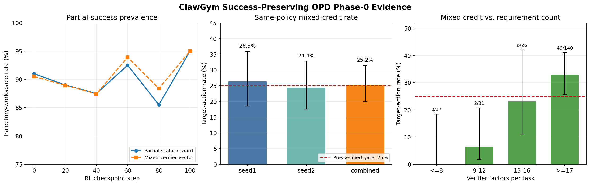

# ClawGym Success-Preserving Hindsight OPD：Phase-0 初步验证报告

日期：2026-08-31
对应方案：[ClawGym_OPD_Precheck_Plan.docx](./ClawGym_OPD_Precheck_Plan.docx)

## 1. 执行摘要

本轮结论是 **Conditional GO（有条件继续）**，不是全面 GO，也不是 NO-GO。

- **H1（verifier 可分解）明确成立。** 随机抽取的 500 个训练任务全部能够稳定输出至少两个具名 requirement-level factor；已有 6 个 checkpoint、共 1,200 次 eval workspace 中，成功执行 verifier 的样本也几乎全部可分解。该基础设施足以支撑 criterion-level 研究。
- **H2（failure-relevant action 具有 mixed credit）在高复杂度任务上得到边界性支持。** 在两个独立、同 checkpoint、每题约 8 条 rollout 的批次中，使用“同策略 peer 的精确单次 write 替换”进行 verifier 反事实重放：最严格口径合计为 `54/214 = 25.23%`；两个批次分别为 `26.32%` 和 `24.37%`。点估计达到预设 25% 门槛，但 task-group cluster bootstrap 95% 区间较宽（12.30%–38.13%）。
- **现象具有明显条件性。** verifier factors ≥17 的任务为 `46/140 = 32.86%`，而 factors ≤8 的任务为 `0/17`。因此论文问题应聚焦“多要求、相互耦合的 artifact-producing agent tasks”，不能宣称所有 agent turn 普遍存在 25% mixed credit。
- **H3（真实 targeted OPD 更新造成 success regression）尚未被直接验证。** 当前 peer rewrite 是比 checkpoint 对比更强的因果代理，但它不是一次 HINT-SD/OPD gradient update。Judge attribution 的重复稳定性也尚未测试。因此现有证据足以批准一个小规模 one-step pilot，尚不足以批准完整正式训练。

最终建议：只在 factor 数较高的任务上开展一个受控 one-step correction 实验；若真实 naive targeted correction 的 passed-factor regression 可复现地达到 5%–10%，再进入 success-preserving 算法训练。



## 2. 原方案门槛与当前判定

| 检查项 | 原方案门槛 | 当前证据 | 判定 |
|---|---:|---|---|
| Verifier 可分解性 | ≥70% | 训练抽样 500/500；成功 eval verifier 近 100% | **GO** |
| Partial-success 覆盖 | ≥20% | 各 checkpoint 为 85.5%–95.0% | **GO** |
| Mixed-credit Rate | ≥25%；<15% no-go | 最严格同策略 action 口径 25.23%；高 factor 子集 32.86% | **Conditional GO** |
| Regression Rate | ≥5%–10%，且可复现 | peer rewrite 代理中，25.23% failure-relevant target action 存在 collateral regression；尚非真实更新 | **未完成** |
| Judge 稳定性 | 重复 top-k overlap 较高 | 本轮用 verifier 反事实干预替代 judge；未测 judge | **未完成** |

这里必须区分三种概念：

1. `mixed final workspace`：最终 workspace 同时有 passed 和 failed factors，只说明任务是 partial success；
2. `mixed artifact intervention`：只替换一个 artifact 后，同时出现 0→1 与 1→0，具有 artifact-level 因果含义；
3. `mixed target action`：recipient 与 donor 都能回链到 byte-exact single-write action，且替换该 action 产物同时 correction 与 regression；这是本报告用于 H2 的最严格单位。

三者不能互相替代。

## 3. 数据与实验设计

### 3.1 Verifier 审计

- 训练集：固定 seed `20260831` 随机抽 500 个任务。
- Eval：正式 retain-all 重训的 step 0、20、40、60、80、100，每个 checkpoint 200 题。
- 实际 verifier 入口是 `reward/check.py`；原方案中的 `reward/test.py` 是路径描述误差。
- `factorized` 定义：verifier 返回至少两个具名、非 aggregate 的 scalar factor。
- 每个 workspace 对 verifier 重复执行，以检查结果稳定性。

### 3.2 同策略 peer rewrite 反事实

使用两个同一 checkpoint 的独立 rollout 批次：

| 批次 | Task groups | 已归档 rollout | Baseline verifier 可用/稳定 | Sidecar 一致 |
|---|---:|---:|---:|---:|
| seed1 | 32 | 254 | 254/254 | 253/254 |
| seed2 | 32 | 236 | 235/236 | 233/236 |
| 合计 | 64 | 490 | 489/490 | 486/490 |

对同一 task group 内的 recipient workspace 和 peer workspace：

1. 保持 recipient workspace 的其他文件不变；
2. 每次只把一个 artifact 替换为 peer 版本；
3. 从干净临时目录重放官方 verifier；
4. recipient 原版本和 donor 新版本都必须能回链到日志中的 byte-exact single `write`；
5. 若替换修复至少一个原失败 factor，则原 target action 是 failure-relevant；
6. 若同一次替换还损坏至少一个原通过 factor，则标记为 mixed；
7. 同一 recipient target action 即便有多个 donor 版本也只计一次，避免 donor 数量膨胀分母。

这一设计的优点是：模型 checkpoint、task、初始 workspace 和 verifier 不变，只改变一个可追溯 action 的产物。它比跨 checkpoint reward 变化更接近因果归因，也避免 LLM judge 把 outcome 信息误当作局部责任。

但它仍有明确边界：peer 版本是另一次 on-policy rollout 中真实出现的可行 correction，不是梯度更新后由同一模型重新生成的结果。

### 3.3 干预规模

- 同策略 peer 单 artifact 干预：13,860 次；成功执行 verifier 13,855 次。
- 其中满足 recipient/donor 均为 exact single-write 的 correction 干预：705 次。
- 去重后的 failure-relevant target actions：214 个，来自 35 个有贡献的 task groups。
- 跨 checkpoint artifact 审计另执行 13,555 次，全部 verifier 成功；该结果仅作稳健性和案例发现，不用于主要 H2 比例。

## 4. H1：Verifier 与 partial-success 是否足够

### 4.1 训练任务 verifier

| 指标 | 结果 |
|---|---:|
| 随机任务数 | 500 |
| Checker 成功 | 500/500 |
| 重复执行稳定 | 500/500 |
| 可分解 verifier | 500/500 |
| 平均 factors/task | 17.462 |
| 中位 factors/task | 16 |

训练任务在初始空 workspace 上只有 3% mixed outcome，这并不表示 mixed-credit 稀少：空 workspace 通常使多数交付项同时失败，它不是模型 rollout 后的状态。

### 4.2 Eval workspace

| RL step | 可审计 workspace | Partial scalar reward | Mixed verifier vector | Mean reward |
|---:|---:|---:|---:|---:|
| 0 | 200 | 91.0% | 90.5% | 0.5582 |
| 20 | 199 | 89.0% | 88.9% | 0.5330 |
| 40 | 199 | 87.5% | 87.4% | 0.5154 |
| 60 | 197 | 92.5% | 93.9% | 0.5362 |
| 80 | 198 | 85.5% | 88.4% | 0.5375 |
| 100 | 200 | 95.0% | 95.0% | 0.5560 |

两类 verifier 异常需要记录但不改变总体结论：

- `task_0151`：offset-naive 与 offset-aware datetime 比较触发 `TypeError`；
- `task_0002`：畸形输出使 checker 对字符串调用 `.get()`。

结论：H1 和 partial-success 门槛都大幅通过，ClawGym 具备做 requirement-level preservation 的数据基础。

## 5. H2：Mixed-credit 的主要结果

### 5.1 两批独立复现

| 数据 | Mixed target actions | Failure-relevant target actions | 比例 | Action-level Wilson 95% CI |
|---|---:|---:|---:|---:|
| seed1 | 25 | 95 | 26.32% | 18.51%–35.97% |
| seed2 | 29 | 119 | 24.37% | 17.54%–32.81% |
| 合并 | 54 | 214 | **25.23%** | 19.89%–31.45% |

以 task group 为 cluster 做 50,000 次 bootstrap，合并结果的 95% 区间是 **12.30%–38.13%**。该区间显著宽于 action-level Wilson 区间，原因是 214 个 action 并非 214 个完全独立任务，而是聚集在 35 个 task groups 中。

因此严谨表述应为：

> 点估计达到预设 25% 门槛，并在两个独立任务批次中复现；但独立 task group 数仍不足以证明总体真实率稳定高于 25%。

### 5.2 现象随任务复杂度变化

| Verifier factors/task | Mixed | Target actions | 比例 | Wilson 95% CI |
|---|---:|---:|---:|---:|
| ≤8 | 0 | 17 | 0.00% | 0.00%–18.43% |
| 9–12 | 2 | 31 | 6.45% | 1.79%–20.72% |
| 13–16 | 6 | 26 | 23.08% | 11.03%–42.05% |
| ≥17 | 46 | 140 | **32.86%** | 25.63%–41.00% |

mixed credit 主要出现在多要求任务中。这符合一个合理机制：同一个最终 artifact 需要同时承载更多格式、内容、安全和一致性约束，纠正其中一个约束时更容易破坏另一个约束。

该分层也是最重要的算法设计提示：success-preserving OPD 不应对所有 task/turn 无条件启用；更合理的是按 factor count、当前 passed-set 大小或检测到的 criterion conflict 做门控。

### 5.3 与轨迹长度的关系

| Recipient agent steps | Mixed | Target actions | 比例 |
|---|---:|---:|---:|
| ≤10 | 51 | 191 | 26.70% |
| 11–20 | 2 | 17 | 11.76% |
| 21–40 | 1 | 6 | 16.67% |

这个结果不能解释为“短轨迹更容易 mixed”。exact single-write 筛选天然偏向一次性生成最终交付文件的短轨迹，长轨迹常含多次 edit/write，较难满足 byte-exact single-write 条件。当前最可信的 moderator 是 factor count，而不是 trajectory length。

## 6. 代表性因果案例

### 6.1 `task_0255`：内容完整性与格式约束互相伤害

目标文件为 `output/message_to_artist.txt`。同策略 peer 的精确 write 版本能够补齐两条 albedo 路径，但同时使 bullet 数不再满足 3–5 条；反向替换又能恢复 bullet 数，却丢失两条路径。它说明“负责补内容的 action”不是纯好或纯坏，artifact 的两个 requirement 真实耦合。

### 6.2 `task_1030`：模板变量修复与清理/签名要求互相伤害

对 `family_checkin.md` 的 peer rewrite 可以修复变量重命名或删除重复 signoff，却重新引入 lunch placeholder、明文内容或丢失签名。多个独立 peer 版本出现同类 trade-off，降低了单一偶然文本造成结果的可能性。

### 6.3 `task_1864`：安全检查清单覆盖项互相替代

对 `review-checklist.json` 的 rewrite 可以修复 SEC-005 和 summary counts，但会丢失 SEC-004，部分版本还会丢失 SEC-002。这是典型的集合覆盖型 collateral damage：纠错版本看似更正确，却遗漏原版本已经覆盖的检查类别。

### 6.4 30 个审计案例索引

下表每行是一个去重后的 recipient exact-write target action；完整 donor hash、correction/regression 列表和日志绝对路径保存在 [opd_same_policy_statistics_20260831.json](./opd_same_policy_statistics_20260831.json)。

| # | 批次 | Task | Artifact | Factors | 至少一个被修复 factor | 至少一个被破坏 factor | Target log line |
|---:|---|---|---|---:|---|---|---:|
| 1 | seed2 | task_1030 | `output/revised_templates/family_checkin.md` | 25 | family_variable_renames_correct | family_lunch_placeholder_and_plaintext_removed | 159 |
| 2 | seed2 | task_1864 | `output/review-checklist.json` | 27 | has_SEC_005_auth; summary counts | has_SEC_004_auth_or_frontend | 258 |
| 3 | seed1 | task_1862 | `output/decisions/decision_log.md` | 31 | irreversible heading | ≥3 bullets; ≥2 owners | 376 |
| 4 | seed2 | task_1864 | `output/review-checklist.json` | 27 | summary counts | has_SEC_004_auth_or_frontend | 345 |
| 5 | seed1 | task_0255 | `output/message_to_artist.txt` | 26 | both albedo paths | 3–5 bullets | 168 |
| 6 | seed1 | task_0255 | `output/message_to_artist.txt` | 26 | both albedo paths | 3–5 bullets | 199 |
| 7 | seed1 | task_1555 | `output/rewritten_messages.csv` | 9 | SMS constraints | content calendar | 269 |
| 8 | seed2 | task_1030 | `output/revised_templates/family_checkin.md` | 25 | signature appended | duplicate signoffs removed | 157 |
| 9 | seed2 | task_1839 | `output/setup_guide.md` | 18 | no secret leak | ≥5 safety rules | 109 |
| 10 | seed2 | task_1864 | `output/review-checklist.json` | 27 | SEC-002 DB | summary counts | 260 |
| 11 | seed1 | task_0255 | `output/message_to_artist.txt` | 26 | 3–5 bullets | both albedo paths | 255 |
| 12 | seed1 | task_0255 | `output/message_to_artist.txt` | 26 | 3–5 bullets | both albedo paths | 225 |
| 13 | seed1 | task_0255 | `output/message_to_artist.txt` | 26 | 3–5 bullets | both albedo paths | 215 |
| 14 | seed1 | task_0357 | `output/posts/posts.json` | 13 | unique derived hashtags | media file/alt text | 165 |
| 15 | seed1 | task_1075 | `output/launch_plan.md` | 19 | phase count | launch day | 242 |
| 16 | seed1 | task_1075 | `output/readiness.json` | 19 | blockers match | decision/scores match | 371 |
| 17 | seed1 | task_1555 | `output/rewritten_messages.csv` | 9 | SMS constraints | content calendar | 261 |
| 18 | seed1 | task_1862 | `output/strategy/diagnosis.json` | 31 | routing items valid | computed metrics | 423 |
| 19 | seed1 | task_1862 | `output/strategy/diagnosis.json` | 31 | routing items valid | computed metrics | 426 |
| 20 | seed1 | task_1862 | `output/strategy/diagnosis.json` | 31 | computed metrics | routing items valid | 361 |
| 21 | seed1 | task_1862 | `output/strategy/diagnosis.json` | 31 | computed metrics | routing items valid | 341 |
| 22 | seed2 | task_0713 | `output/skills_catalog.json` | 16 | official partner coverage | all skills in phases | 424 |
| 23 | seed2 | task_0713 | `output/skills_catalog.json` | 16 | official partner coverage | all skills in phases | 341 |
| 24 | seed2 | task_0713 | `output/skills_catalog.json` | 16 | official partner coverage | all skills in phases | 485 |
| 25 | seed2 | task_1030 | `output/revised_templates/family_checkin.md` | 25 | placeholder/plaintext removed | variable renames | 230 |
| 26 | seed2 | task_1030 | `output/revised_templates/family_checkin.md` | 25 | placeholder/plaintext removed | variable renames | 156 |
| 27 | seed2 | task_1030 | `output/report.json` | 25 | shipper variables match | family variables match | 377 |
| 28 | seed2 | task_1864 | `output/review-checklist.json` | 27 | SEC-004 | summary counts | 370 |
| 29 | seed2 | task_1864 | `output/review-checklist.json` | 27 | SEC-004 | summary counts | 255 |
| 30 | seed2 | task_1864 | `output/review-checklist.json` | 27 | SEC-004 | summary counts | 381 |

这些案例用于论文 motivation 足够，但不能把同一 task 下的多行当作独立任务证据；统计置信区间已按 task group cluster 重采样以部分处理这一点。

## 7. H3 为什么仍未通过

当前同策略干预已经证明：在存在可行 correction 的 action 上，采用另一条 on-policy rollout 的纠错版本，约四分之一会破坏原 passed factors。但它没有完成以下因果链：

```text
failure-localized training signal
  -> 一次真实参数更新
  -> 固定评测协议重新 rollout
  -> failed factor correction + passed factor regression
```

peer rewrite 是“内容替换干预”；H3 要求的是“学习更新干预”。两者之间可能存在差异：

- gradient update 可能只轻微改变 token distribution，不会完整复制 donor artifact；
- 更新可能影响其他 turn 和其他 task，而 peer rewrite 只改变一个文件；
- judge localization 的误差可能成为主要因素；
- 重新 rollout 的工具结果与环境状态会增加方差。

同理，跨 checkpoint 观察到约 14%–20% 的 factor correction 和约 14%–18% 的 regression，也不能当作 H3：checkpoint 间包含大量 task、sampling 和全参数更新差异，不是 targeted correction 的对照实验。

## 8. Judge attribution：本轮为何没有直接使用

本轮优先使用 deterministic verifier intervention，是因为它比 LLM judge 的“这个 turn 负责哪个失败”更强、更可审计，并且避免已知的 outcome-confounded localization：看到最终失败并不等于能正确定位局部失败动作。

这不表示 Judge gate 已通过。如果最终算法依赖 judge 选择 span/turn，下一阶段仍必须测：

- 同一轨迹重复询问的 top-k overlap；
- 对 correction factor 的 recall；
- 对 protected passed factors 的 attribution precision；
- 隐去最终 outcome 后的定位稳定性；
- 与本轮 exact-write verifier intervention 标签的一致率。

一种更稳妥的论文设计是：verifier 提供 criterion-level protected set，judge 只用于提高候选 action recall，而不让 judge 单独决定 preservation label。

## 9. 与相邻工作的关系和剩余创新空间

- [HINT-SD](https://arxiv.org/abs/2605.17873) 已经使用 hindsight 信号寻找 failure-relevant actions 并对目标 action span 做蒸馏，因此“只训练失败相关动作”本身不构成新颖贡献。
- [Outcome-Confounded Local Supervision in On-Policy Distillation](https://arxiv.org/abs/2607.23731) 指出局部 teacher/student 差异可能与最终 outcome 混淆；这支持本报告使用 verifier 反事实而非把局部差异直接解释成责任。
- [SDAR](https://arxiv.org/abs/2605.15155) 已讨论多轮 on-policy distillation 的稳定性及门控/非对称约束，因此泛化的“加一个 KL 防止更新过大”也较难成为核心创新。
- [HERO](https://arxiv.org/abs/2606.11559) 使用环境 observation 做 hindsight reflection/local alignment，进一步压缩了普通 hindsight correction 的创新空间。

当前仍可能成立的主线不是“更好的失败定位”，而是：

> 在多 criterion agent task 中，把纠错建模成受 protected-success constraints 约束的 Pareto update；只在检测到 criterion conflict 时启用 preservation，并验证其比无约束 targeted OPD 具有更高 Net Repair。

潜在算法必须至少显式使用以下一种新信息，否则容易退化成已有方法：

- verifier-derived passed criterion set；
- criterion-conditioned token/action credit；
- correction gradient 与 preservation gradient 的冲突检测/投影；
- 基于 factor complexity 的条件门控；
- 对同一 action 的 correction/preservation Pareto frontier。

## 10. 下一步最小实验：One-step H3 Pilot

### 10.1 样本与对照

建议只选 factors ≥17 的 50–100 个 target-action cases，并保留 task-group 分组。每个 case 固定：初始 workspace、checkpoint、sampling identity、工具环境与 verifier 版本。

至少比较：

1. `No-update / rerollout control`：估计纯采样和环境噪声；
2. `Naive HINT-SD-style targeted correction`：只蒸馏 correction span；
3. `Success-preserving candidate`：增加 protected passed-factor signal；
4. 可选 `full-trajectory OPSD`：验证局部化本身的收益。

### 10.2 必须报告的无条件指标

不能只在“已经成功 correction”的样本上计算。对所有预注册 target cases 报告：

| 指标 | 定义 |
|---|---|
| Attempted Correction Rate | 原 failed factors 中 0→1 的比例 |
| Passed-factor Regression Rate | 原 passed factors 中 1→0 的比例 |
| Any-regression Case Rate | 至少一个 passed factor 回退的 case 比例 |
| Net Repair | correction count − regression count（主结果另报告不同 α） |
| Whole-task reward delta | 更新后 scalar verifier reward 变化 |
| Unrelated-task retention | held-out tasks 上是否退化 |

配对统计应以 task group 为重采样单位；同时给 point estimate、Wilson/cluster bootstrap CI，而不是只报告 action 数。

### 10.3 下一阶段 GO / NO-GO

- `Naive targeted correction` 相对 no-update 明显提高 correction；
- 其 passed-factor regression ≥5%–10%，且在至少两个 seed 中方向一致；
- preservation 方法在 correction 不显著下降的情况下，降低 regression 或提高 Net Repair；
- judge 若参与选 turn，需通过预先规定的稳定性门槛。

若 naive correction 的真实 regression 接近 no-update control，或只在极少数 task 模板出现，则 success-preserving 算法主张不成立，应停止该路线或降级为特定任务现象。

## 11. 有效性威胁与不能过度解读的结果

1. **条件分母。** 25.23% 是“至少存在一个同策略 exact-write correction 的 failure-relevant action”中的比例，不是所有 assistant turns 的比例。
2. **任务聚类。** mixed actions 集中在少数高 factor tasks；action-level CI 会低估不确定性，因此主文应同时报告 cluster bootstrap。
3. **Exact-write 选择偏差。** 多次 edit、跨文件协作、shell 生成文件和隐式状态修改暂未进入最严格 action 分母。
4. **Artifact 不等于 token span。** 精确 write 能定位生成该文件的工具参数 token，但无法证明其中每个 token 对每个 factor 的贡献。
5. **Peer correction 不是训练更新。** 它证明现象和算法必要性的可能性，不证明目标 loss 已经有效。
6. **Verifier bugs。** 极少数 checker 对畸形 workspace 不鲁棒；后续 pilot 应预注册 checker error 的处置规则，不把 infrastructure error 当作 reward=0。
7. **Judge 未测。** 如果算法依赖 judge，本轮 verifier 证据不能替代 judge reliability audit。

## 12. 最终决策

### 可以确认

- ClawGym verifier 高度可分解、稳定，partial success 丰富；
- 同一可追溯 artifact-writing action 确实可能同时维持已通过要求和阻碍另一个要求；
- 该现象在两个独立 rollout 批次复现；
- 现象在高 factor tasks 上足够强，具有明确的研究价值和可操作的条件门控信号。

### 尚不能确认

- HINT-SD/OPD 的一次真实参数更新是否产生 ≥5%–10% collateral regression；
- success-preserving loss 是否比无约束 targeted correction 更好；
- judge 能否稳定找到对应 action/span；
- 该现象是否能泛化到低 factor tasks、非 write action 和更多 task groups。

### 决策

**批准小规模 H3 one-step pilot；不批准直接进行完整正式 OPD 训练。**

论文方向应收敛为“high-complexity criterion-conflict 下的 conditional success-preserving OPD”，而不是泛化的“所有失败轨迹都需要保留成功部分”。

## 13. 复现入口与产物

核心代码：

- [opd_precheck_audit.py](./opd_precheck_audit.py)
- [opd_artifact_swap_audit.py](./opd_artifact_swap_audit.py)
- [opd_map_action_provenance.py](./opd_map_action_provenance.py)
- [opd_same_policy_peer_swap.py](./opd_same_policy_peer_swap.py)
- [opd_same_policy_statistics.py](./opd_same_policy_statistics.py)
- [plot_opd_precheck.py](./plot_opd_precheck.py)

主要结果：

- [opd_precheck_factor_audit_20260831.summary.json](./opd_precheck_factor_audit_20260831.summary.json)
- [opd_same_policy_peer_swap_seed1_20260831.json](./opd_same_policy_peer_swap_seed1_20260831.json)
- [opd_same_policy_peer_swap_seed2_20260831.json](./opd_same_policy_peer_swap_seed2_20260831.json)
- [opd_same_policy_statistics_20260831.json](./opd_same_policy_statistics_20260831.json)
- [opd_artifact_swap_audit_20260831.json](./opd_artifact_swap_audit_20260831.json)
- [opd_action_provenance_20260831.json](./opd_action_provenance_20260831.json)
- [opd_precheck_statistics_20260831.json](./opd_precheck_statistics_20260831.json)
- [汇总图](./figures/opd_precheck_summary_20260831.png)

关键复现命令的结构如下（路径均为本机绝对数据路径；正式重跑前应写入独立输出文件）：

```bash
cd /root/openclaw-rl-local

python3 research/opd_precheck_audit.py \
  --train-root /root/openclaw-rl-local/clawgym-official/data/clawgym_train \
  --eval-root /root/openclaw-rl-local/clawgym-official/data/clawgym_eval \
  --artifact-root /root/openclaw-rl-local/outputs/clawgym-official-30b-formal-retrain-routing-tis-det-retry1-20260826-0129/eval_artifacts \
  --train-sample-size 500 --seed 20260831 --workers 16 \
  --output research/opd_precheck_factor_audit_REPRO.json

python3 research/opd_same_policy_peer_swap.py \
  --run-dir /root/openclaw-rl-local/outputs/mosaic-phase0-32x8-seed1-20260822-023000 \
  --train-root /root/openclaw-rl-local/clawgym-official/data/clawgym_train \
  --workers 8 --output research/opd_same_policy_peer_swap_seed1_REPRO.json

python3 research/opd_same_policy_peer_swap.py \
  --run-dir /root/openclaw-rl-local/outputs/mosaic-p2-provenance-32x8-seed2-20260823-031443 \
  --train-root /root/openclaw-rl-local/clawgym-official/data/clawgym_train \
  --workers 8 --output research/opd_same_policy_peer_swap_seed2_REPRO.json

python3 research/opd_same_policy_statistics.py \
  --audit seed1 research/opd_same_policy_peer_swap_seed1_REPRO.json /root/openclaw-rl-local/outputs/mosaic-phase0-32x8-seed1-20260822-023000 \
  --audit seed2 research/opd_same_policy_peer_swap_seed2_REPRO.json /root/openclaw-rl-local/outputs/mosaic-p2-provenance-32x8-seed2-20260823-031443 \
  --bootstrap-repeats 50000 --seed 20260831 \
  --output research/opd_same_policy_statistics_REPRO.json
```

所有统计脚本已通过 `python3 -m py_compile`。本轮 verifier replay 为 CPU 工作；验证期间 8 张 GPU 持续运行烤机任务，没有因本轮审计而闲置。
